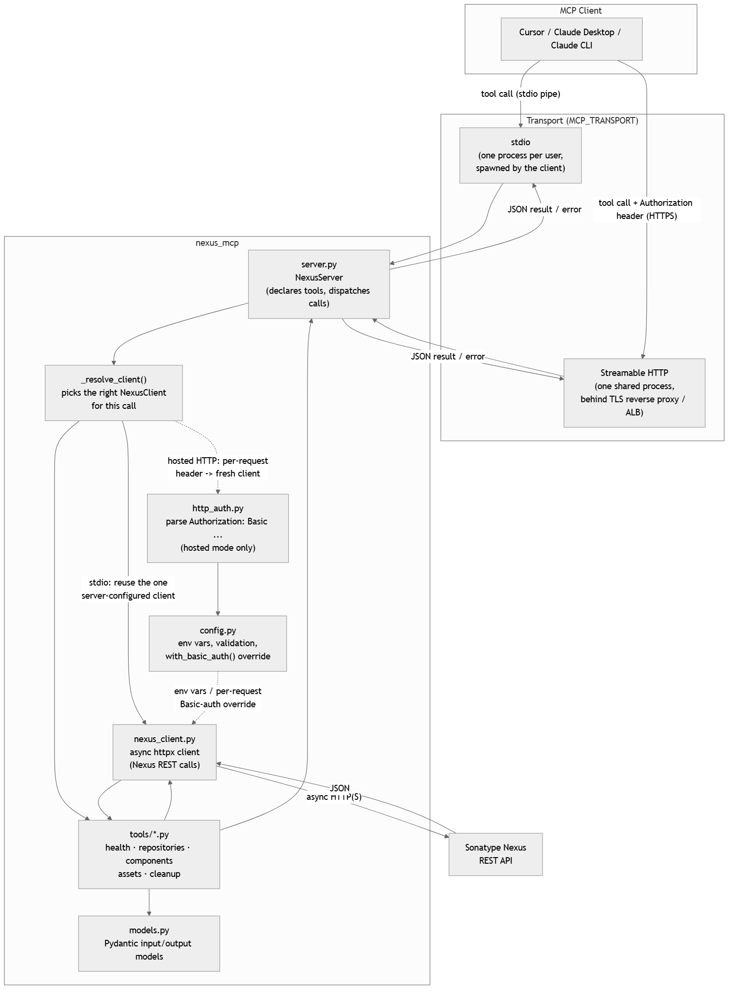
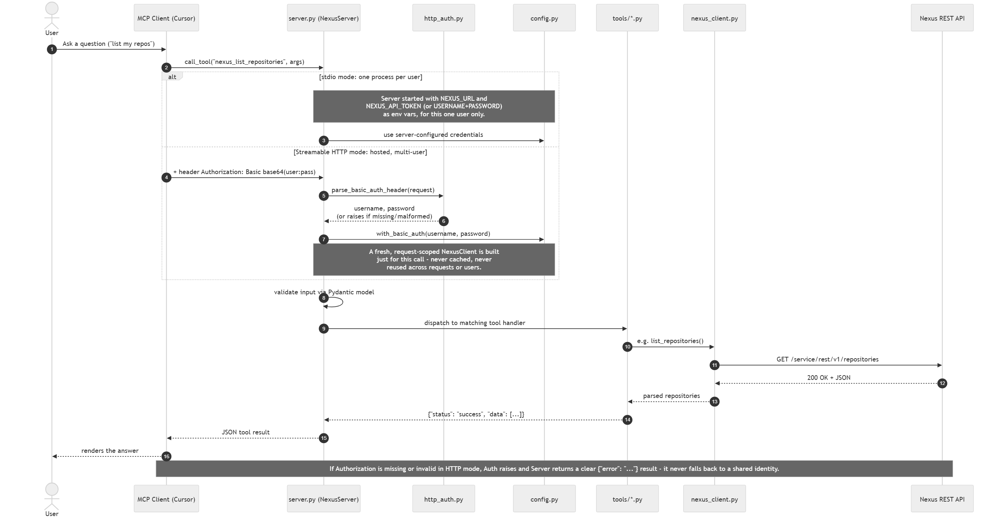
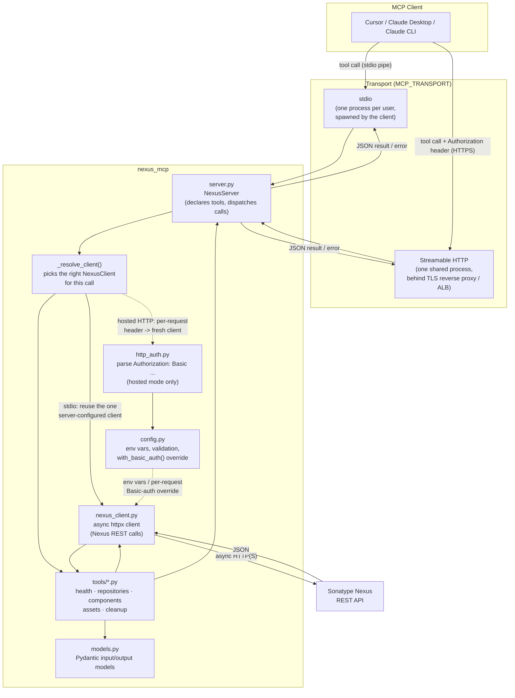
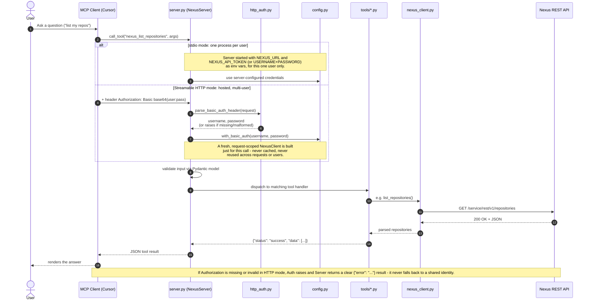

# Sonatype Nexus OSS MCP Server

A Model Context Protocol (MCP) server for Sonatype Nexus OSS written in Python. This server enables AI assistants to query repositories, browse components, inspect assets, and perform common management operations through the Nexus REST API.

## Features

- Repository Management: List, create, and inspect repositories
- Component Search: Search and retrieve components with filters
- Asset Management: Inspect assets and download metadata
- Upload Components: Upload artifacts to hosted repositories
- Health Checks: Verify Nexus connectivity and authentication

## Architecture & Request Flow

How a tool call moves through the codebase, and how that differs between the
two transports (see ["Hosted / Multi-user Deployment"](#hosted--multi-user-deployment-streamable-http)
below for the full explanation of `stdio` vs `http`):



- `server.py` declares the MCP tools and dispatches each call.
  `_resolve_client()` decides which `NexusClient` handles it: the one
  server-configured client for `stdio`, or a brand-new, request-scoped one
  built from that request's `Authorization` header for hosted `http`.
- `tools/*.py` shapes the actual operation (list repositories, search
  components, etc.) and talks to Nexus only through `nexus_client.py` —
  never directly with `httpx`.
- `config.py` owns environment configuration and, in hosted mode,
  `with_basic_auth()` produces a per-request override instead of using any
  server-side credentials.
- `http_auth.py` / `http_app.py` exist only for hosted HTTP: parsing the
  Basic-auth header and wiring up the Streamable HTTP ASGI app.

Zooming into a single tool call end-to-end, and how the two transports
diverge at the credentials step:



Sources: [`docs/architecture.mmd`](docs/architecture.mmd) /
[`docs/request-flow.mmd`](docs/request-flow.mmd) — edit those and re-render
with `npx @mermaid-js/mermaid-cli -i docs/x.mmd -o docs/x.png` rather than
editing the PNGs directly:

<details>
<summary>Mermaid source (renders inline on GitLab)</summary>





</details>

## Installation

### Prerequisites

- Python 3.11 or higher
- Docker (optional, for containerized deployment)
- A running Sonatype Nexus OSS instance
- Nexus API token or username/password credentials

### Setup

1. Clone or navigate to the project directory:
```bash
cd nexus-mcp
```

2. Install the package with development dependencies:
```bash
pip install -e ".[dev]"
```

## Configuration

Configure the server using environment variables:

### Required
- `NEXUS_URL` — Your Nexus server URL (e.g., https://nexus.example.com/nexus)

### Authentication (choose one)

**Option 1: API Token (Recommended)**
```env
NEXUS_API_TOKEN=your-api-token-here
```

**Option 2: Username & Password**
```env
NEXUS_USERNAME=admin
NEXUS_PASSWORD=password
```

### Optional
- `LOG_LEVEL` — Logging level (DEBUG, INFO, WARNING, ERROR, CRITICAL). Default: INFO
- `ALLOW_INSECURE` — Allow non-HTTPS URLs (true/false). Default: false. Only for development.
- `NEXUS_REPO_INFO_URL` — Base URL of an optional, org-specific repo-ownership portal used by `nexus_get_repository_owner` (a separate page, not Nexus's REST API — most Nexus deployments won't have one). No default; leave unset to disable that one tool, or set it to your own portal's URL, e.g. `https://nexus.example.com/nexus-repo-info/`.
- `MCP_TRANSPORT` — `stdio` (default) or `http`. See ["Hosted / Multi-user Deployment"](#hosted--multi-user-deployment-streamable-http) below before using `http` — it changes how (and whether) `NEXUS_USERNAME`/`NEXUS_PASSWORD`/`NEXUS_API_TOKEN` above are used.
- `MCP_HTTP_HOST` / `MCP_HTTP_PORT` — Bind address/port for `MCP_TRANSPORT=http`. Defaults: `0.0.0.0` / `8000`. Unused for `stdio`.

## Getting Credentials

### Option 1: Use Username & Password (Simple)

Just use your Nexus login credentials:
- **Username:** Your Nexus username
- **Password:** Your Nexus password

No additional setup needed!

### Option 2: Create an API Token (Optional)

If you want to use an API token instead:

1. Log in to your Nexus instance: https://nexus.example.com/nexus/
2. Click your username (top right corner)
3. Select "API Token"
4. Click "Access API Token" → "Generate New Token"
5. Copy the token
6. Add to your configuration

**Note:** If API Token option is not available, use username & password instead (Option 1).

## Running the Application

### Option 1: Direct Python

```bash
# Set environment variables
export NEXUS_URL=https://nexus.example.com/nexus
export NEXUS_API_TOKEN=your-api-token

# Run the server
nexus-mcp
```

### Option 2: Docker (Recommended)

**Build the image:**
```bash
docker build -t nexus-mcp:latest .
```

**Run through an MCP client:**
```bash
docker run --rm -i \
  -e NEXUS_URL=https://nexus.example.com/nexus \
  -e NEXUS_USERNAME=your-username \
  -e NEXUS_PASSWORD=your-password \
  nexus-mcp:latest
```

The server uses MCP's stdio transport, so it must be started by the MCP client
with `-i`; it is not a long-running HTTP service. Do not use `-d` or `-t`.
Each user supplies their own `NEXUS_URL` and either `NEXUS_USERNAME` /
`NEXUS_PASSWORD` or `NEXUS_API_TOKEN` at runtime. Never bake these values into
the image.

### GitLab CI/CD image publishing

> **Note:** this project's CI/CD was originally built around GitLab CI and
> is included as-is (`.gitlab-ci.yml`) — it does **not** run automatically
> on GitHub. If you host this repo's `main` on GitHub, either mirror it to
> a GitLab project to use this pipeline, or adapt the steps below into a
> GitHub Actions workflow (contributions welcome — see
> [`CONTRIBUTING.md`](CONTRIBUTING.md)).

The included `.gitlab-ci.yml` runs the test suite, builds the Docker image,
starts a short-lived container to verify the `nexus-mcp` entry point, and
publishes the image on the default branch and tags. Configure these variables
in GitLab under **Settings → CI/CD → Variables**:

| Variable | Purpose |
| --- | --- |
| `NEXUS_DOCKER_REGISTRY` | Docker registry host used for `docker login` (without `https://`). |
| `NEXUS_DOCKER_IMAGE` | Full target image name, for example `registry.example:port/test-docker/nexus-mcp`. Obtain the Docker connector endpoint from the Nexus administrator; the Nexus browse URL is not a registry endpoint. |
| `NEXUS_DOCKER_USERNAME` | Account permitted to push to the `test-docker` hosted repository. |
| `NEXUS_DOCKER_PASSWORD` | Password or token for that account. |

Mark the username and password variables **Masked** and **Protected**, and
restrict them to protected branches/tags. This pipeline is configured for a
GitLab **shell runner**: Docker must be installed on the runner host and the
`gitlab-runner` user must be permitted to run `docker` commands. Configure the
runner host's corporate CA trust if the Nexus registry certificate is not
already trusted.

### GitLab CI/CD: auto-deploying the hosted HTTP container

A third stage, `deploy-http-container`, runs after `package-image` (same
rules: default branch and tags) and keeps **one** long-lived container on the
runner host always pointed at the exact image the pipeline just built and
pushed (by its `CI_COMMIT_SHORT_SHA` tag, not `:latest` — `package-image`
only pushes `:latest` for default-branch pipelines, and this job's rules also
allow tag pipelines) — it stops and removes whatever was running under that
name first, so it never drifts from the newest pipeline run. This is the same `MCP_TRANSPORT=http`
container described in ["Hosted / Multi-user
Deployment"](#hosted--multi-user-deployment-streamable-http) above, just kept
up to date automatically. Configure one more variable:

| Variable | Purpose |
| --- | --- |
| `NEXUS_MCP_NEXUS_URL` | The Nexus URL the *hosted server itself* connects to (e.g. `https://nexus.example.com/nexus`) — **not** a credential. Do not set any `NEXUS_USERNAME`/`NEXUS_PASSWORD`/`NEXUS_API_TOKEN` variable for this job: each MCP client request carries its own Nexus identity via its `Authorization` header instead (see above) — a server-wide credential here would defeat that isolation. |

Optional, with sensible defaults if unset:

| Variable | Default | Purpose |
| --- | --- | --- |
| `NEXUS_MCP_CONTAINER_NAME` | `nexus-mcp-http` | Container (and log volume) name — fixed so redeploys find and replace the right one. |
| `NEXUS_MCP_HTTP_PORT` | `8000` | Host port published to the container's `8000`. |

The job pulls the image, creates (or reuses) a `<container-name>-logs` Docker
volume mounted at `/app/logs` so logs survive redeploys, replaces the
container, and polls `GET /healthz` for up to ~30s before succeeding —
failing the job (with the new container's logs printed) if it never becomes
healthy. Put a TLS-terminating reverse proxy in front of this port in
production; the pipeline only manages the container itself.

### Option 3: docker-compose (Full Stack)

**Create `.env` file:**
```env
NEXUS_URL=https://nexus.example.com/nexus
NEXUS_USERNAME=admin
NEXUS_PASSWORD=admin123
LOG_LEVEL=INFO
```

**Start services:**
```bash
docker-compose up -d
```

**View logs:**
```bash
docker-compose logs -f nexus-mcp
```

**Stop services:**
```bash
docker-compose down
```

## Hosted / Multi-user Deployment (Streamable HTTP)

Everything above runs `MCP_TRANSPORT=stdio` (the default): **one process per
user**, spawned by the MCP client itself, with that one user's Nexus
credentials loaded from env vars for the life of the process — the WSL/Docker
setup described throughout this README.

If you'd rather host this server **once**, centrally, and just hand users a
URL + client config, use `MCP_TRANSPORT=http` instead. This is a different
trust model, not just a different transport:

- There is no longer "the" server identity. `NEXUS_USERNAME`/`NEXUS_PASSWORD`/
  `NEXUS_API_TOKEN` become **optional** server-side — normally leave them
  unset entirely.
- Instead, **every request must carry its own Nexus identity** as an
  `Authorization: Basic <base64(username:password)>` header. The server
  builds a fresh, request-scoped Nexus client from that header for each
  call — it is never cached, never reused across requests, and the server
  never falls back to a shared identity, even if one happens to be
  configured. One caller can't end up using another caller's (or the
  server's) Nexus identity by omission.
- Because Basic auth sends real credentials on every single request, **this
  process must sit behind a TLS-terminating reverse proxy** (nginx, same as
  your Nexus setup already has) — it listens on plain HTTP internally and
  does not terminate TLS itself. Don't expose `MCP_HTTP_PORT` directly to
  anything other than that proxy.

### Running the server

```bash
# Same image/codebase as stdio mode -- just a different env var. Do NOT
# also set NEXUS_USERNAME/PASSWORD/API_TOKEN here; leave server-side auth
# unset so a caller can never fall back to it.
docker run --rm -p 8000:8000 \
  -e NEXUS_URL=https://nexus.example.com/nexus \
  -e MCP_TRANSPORT=http \
  nexus-mcp:latest
```

or directly with Python: `MCP_TRANSPORT=http nexus-mcp` (or `nexus-mcp
--transport http`). Put this behind a reverse proxy that terminates TLS and
forwards to `MCP_HTTP_HOST:MCP_HTTP_PORT`; `GET /healthz` is a plain liveness
probe that needs no credentials, and the MCP endpoint itself is `/mcp`.

### Each user's client config

Each user generates their own header value once, then references it via an
env var Cursor substitutes at connect time — the raw value never lives in a
committed config file:

```bash
python -m nexus_mcp.make_basic_auth_header
# Prompts for your Nexus username/password, prints:
#   Basic YWxpY2U6czNjcmV0
# Store that as an env var, e.g. NEXUS_MCP_AUTH, the same way you'd store a
# password (local env var, secrets manager, etc.) -- never in a file
# committed to source control.
```

That helper (`make_basic_auth_header`) is the recommended way — it prompts
with hidden input so your password never lands in shell history or a
terminal scrollback. If you can't run it, any of these produce the exact
same value:

```bash
# Python one-liner (any OS with Python)
python -c "import base64; print('Basic ' + base64.b64encode(b'alice:s3cret').decode())"

# macOS / Linux / WSL
echo -n "alice:s3cret" | base64 --wrap=0

# Windows PowerShell
[Convert]::ToBase64String([Text.Encoding]::UTF8.GetBytes("alice:s3cret"))
```

Each of these leaves the plaintext `username:password` in your shell
history, so prefer `make_basic_auth_header`'s prompt when you can.

```json
{
  "mcpServers": {
    "nexus": {
      "url": "https://nexus-mcp.your-domain.example/mcp",
      "headers": {
        "Authorization": "${env:NEXUS_MCP_AUTH}"
      }
    }
  }
}
```

(`nexus-mcp.your-domain.example` above is a placeholder — point it at
wherever you host this, e.g. an AWS ALB with an ACM-issued TLS cert in
front of the EC2/ECS/etc. host running the container from the CI pipeline
described below.)

If a request arrives with no `Authorization` header (or a malformed/non-Basic
one), every tool call returns a clear `{"error": "..."}` result explaining
what's expected — it never silently proceeds with a default identity.

## Claude Integration

### Claude CLI

Add to `~/.claude/profiles.json` or `claude.json`:

**Option 1: Using Username & Password**

```json
{
  "mcpServers": {
    "nexus": {
      "command": "nexus-mcp",
      "env": {
        "NEXUS_URL": "https://nexus.example.com/nexus",
        "NEXUS_USERNAME": "your-username",
        "NEXUS_PASSWORD": "your-password"
      }
    }
  }
}
```

**Option 2: Using API Token**

```json
{
  "mcpServers": {
    "nexus": {
      "command": "nexus-mcp",
      "env": {
        "NEXUS_URL": "https://nexus.example.com/nexus",
        "NEXUS_API_TOKEN": "your-api-token"
      }
    }
  }
}
```

### Claude Desktop

Add to `~/.claude/claude.json`:

**Option 1: Using Username & Password (Recommended)**

```json
{
  "mcpServers": {
    "nexus": {
      "command": "docker",
      "args": [
        "run", "--rm", "-i",
        "-e", "NEXUS_URL=https://nexus.example.com/nexus",
        "-e", "NEXUS_USERNAME=your-username",
        "-e", "NEXUS_PASSWORD=your-password",
        "nexus-mcp:latest"
      ]
    }
  }
}
```

**Option 2: Using API Token**

```json
{
  "mcpServers": {
    "nexus": {
      "command": "docker",
      "args": [
        "run", "--rm", "-i",
        "-e", "NEXUS_URL=https://nexus.example.com/nexus",
        "-e", "NEXUS_API_TOKEN=your-api-token",
        "nexus-mcp:latest"
      ]
    }
  }
}
```

### Cursor Integration

Add to `.cursor/cursor_settings.json` or in Cursor Settings → MCP Servers:

**Option 1: Using Username & Password (Recommended)**

```json
{
  "mcpServers": {
    "nexus": {
      "command": "docker",
      "args": [
        "run", "--rm", "-i",
        "-e", "NEXUS_URL=https://nexus.example.com/nexus",
        "-e", "NEXUS_USERNAME=your-username",
        "-e", "NEXUS_PASSWORD=your-password",
        "nexus-mcp:latest"
      ]
    }
  }
}
```

**Option 2: Using API Token**

```json
{
  "mcpServers": {
    "nexus": {
      "command": "docker",
      "args": [
        "run", "--rm", "-i",
        "-e", "NEXUS_URL=https://nexus.example.com/nexus",
        "-e", "NEXUS_API_TOKEN=your-api-token",
        "nexus-mcp:latest"
      ]
    }
  }
}
```

Docker-based MCP servers require `-i` to keep standard input open for the MCP
stdio transport. Do not add `-t`, which can alter protocol messages.

#### Cursor on Windows with Docker in WSL

When Cursor runs on Windows but the Docker CLI and image are available only in
WSL, launch Docker through `wsl.exe` rather than using `docker` directly.
Sign in to the private image registry once from WSL before starting Cursor:

```bash
docker login nexus.example.com
```

Use the published `test-docker` image in the Cursor MCP configuration. Each
user supplies their own Nexus credentials at runtime:

```json
{
  "mcpServers": {
    "nexus": {
      "command": "wsl.exe",
      "args": [
        "docker", "run", "--rm", "-i",
        "--pull", "always",
        "-e", "NEXUS_URL=https://nexus.example.com/nexus",
        "-e", "NEXUS_USERNAME=your-username",
        "-e", "NEXUS_PASSWORD=${env:NEXUS_PASSWORD}",
        "nexus.example.com/nexus/repository/test-docker/nexus-mcp:latest"
      ]
    }
  }
}
```

- `--pull always` — `docker run` only pulls an image if that tag isn't
  already cached locally, so without this flag Cursor keeps launching a
  stale, previously-pulled copy of `:latest` forever. This flag makes Docker
  re-check the registry (and re-pull if the digest changed) every time Cursor
  starts this server — i.e. on Cursor startup or when you toggle the server
  off/on in **Customize > MCPs**, not on every chat/tool call, since Cursor
  keeps the process alive in between.
- `NEXUS_PASSWORD=${env:NEXUS_PASSWORD}` — Cursor resolves `${env:VAR_NAME}`
  in `command`/`args`/`env` from your host/WSL environment, so the real
  password lives outside `mcp.json` instead of in plaintext. Set
  `NEXUS_PASSWORD` in your environment before starting Cursor. Note this env
  var is unrelated to `docker login` above — it's passed into the container
  for the app's own Nexus REST API calls, not for pulling the image itself.

If Docker is installed in a non-default WSL distribution, add
`"-d", "distribution-name"` before `"docker"` in `args`. Restart Cursor after
changing the MCP configuration. Keep `-i` and do not add `-t`.

**Or if running Python directly:**

```json
{
  "mcpServers": {
    "nexus": {
      "command": "nexus-mcp",
      "env": {
        "NEXUS_URL": "https://nexus.example.com/nexus",
        "NEXUS_USERNAME": "your-username",
        "NEXUS_PASSWORD": "your-password"
      }
    }
  }
}
```

## Available Tools

### Health & Status
- **nexus_health_check** — Check read availability (`GET /v1/status`, which returns no body — never parsed as JSON) and `auth_valid` via a separate authenticated `/v1/repositories` call (`/v1/status` itself requires no authentication, so it can't confirm credentials on its own). Doesn't report edition/version — Nexus's REST API doesn't expose them without an admin-only endpoint, and the `Server` response header is stripped by many reverse proxies
- **nexus_check_writable** — Check whether this Nexus node currently accepts writes (pre-flight guard before automated uploads)

### Repository Management
- **nexus_list_repositories** — List all repositories
- **nexus_get_repository** — Get repository configuration
- **nexus_get_repository_size** — Total on-disk size (bytes/KiB/MiB/GiB) plus asset and component counts for a repository

### Component Operations
- **nexus_search_components** — Search components with filters
- **nexus_get_component** — Get component details by ID
- **nexus_get_component_versions** — List all distinct versions of a component name, sorted, with the latest surfaced (handy for CI version-bump/dependency workflows)
- **nexus_get_latest_release** — Find the latest release artifact in a repository, by name or across the whole repo (SNAPSHOT-style versions excluded by default)
- **nexus_check_artifact_exists** — Check whether a component (optionally at an exact version) already exists in a repository — a CI pre-flight guard to skip re-publishing an artifact that's already there
- **nexus_get_dependency_snippet** — Generate ready-to-paste Maven/Gradle/npm/Docker/pip snippets (or a direct download URL) for an artifact, auto-resolving the latest release if version/name/format are omitted. For Docker, prefers path-based routing (`docker.pathEnabled` — the form that works behind a reverse proxy like nginx that only exposes HTTPS) over a dedicated connector host:port when both are configured. Also returns `repository_url` and `access_help` (Nexus's REST API has no "required role" concept for a repo, so this points to the ServiceNow request form and the repo-info portal instead)
- **nexus_upload_component** — Upload artifacts to repository
- **nexus_download_component** — Download a component's assets by name (optionally filtered by version/group/format) into a local directory

### Asset Management
- **nexus_get_asset** — Get asset details by ID
- **nexus_get_download_url** — Resolve one or more direct download URLs by asset_id or by repository+name coordinates, without fetching content — for CI scripts that just need a URL to hand to curl/wget
- **nexus_download_asset** — Download a single asset's raw content by exact ID, as base64 or saved to a local path (bounded by `max_size_bytes`)

### Activity
- **nexus_latest_uploaded_artifacts** — Most-recently uploaded artifacts, including the uploader when Nexus records it
- **nexus_latest_downloaded_artifacts** — Most-recently downloaded artifacts (see note below on downloader identity)
- **nexus_get_artifact_age_report** — Read-only staleness report: upload age, days since last download (or `never_downloaded`), and classification (`snapshot`, `pre-release`, `mutable-tag` for Docker `latest`/`dev`-style tags, or `release`) per asset, with a `stale` flag for old + unused artifacts. Helps spot SNAPSHOT/pre-release/Docker cleanup candidates without deleting anything.

### Help & Links
- **nexus_info** — Local knowledge-base lookup (no Nexus REST calls) for *your org's own* links: an access-request process (ServiceNow/Jira/etc.), a repo-ownership portal, and internal documentation. Pass a free-text `query` to rank the most relevant link first, or omit it to list everything. Backed by [`nexus/kb/`](nexus/kb/), which ships with generic example placeholders — edit the Markdown files there to point at your own links, no code changes needed.
- **nexus_get_repository_owner** — Optional: look up a repository's owner (plus format/type/access) from an org-specific repo-info portal's data feed (`NEXUS_REPO_INFO_URL` + `repositories.json`) — a separate endpoint, not Nexus's REST API, which has no "owner" concept at all. Requires `NEXUS_REPO_INFO_URL` to be set (no default); returns a clear "not configured" error otherwise. Best-effort even when configured: relies on an undocumented JSON file, not a stable API — if the repository isn't listed, `found` comes back `false` rather than a guessed answer — check the returned `source_url` directly in that case.

> **Note on downloader identity.** Nexus's public REST API exposes the
> `lastDownloaded` timestamp on assets but does **not** expose the username or
> IP of the account that performed the download — that information only lives
> in the audit log (`System → Support → Logs → audit.log`) and is not
> addressable via REST. The `nexus_latest_downloaded_artifacts` tool documents
> this limitation in its `downloader_info` field. Uploader identity *is*
> exposed by Nexus (3.37+) and is returned in the response.

## Usage Examples

### In Claude/Cursor

```
List all repositories in Nexus

Search for all Maven components named "log4j"

Upload my-app-1.0.0.jar to the releases repository

What components are in the snapshots repository?
```

## Testing

Run the test suite:

```bash
pytest
```

Run with coverage:

```bash
pytest --cov=nexus_mcp
```

Run specific test:

```bash
pytest tests/test_health.py
```

## Code Quality

**Linting:**
```bash
ruff check .
```

**Type checking:**
```bash
mypy nexus_mcp
```

**All checks:**
```bash
ruff check .
mypy nexus_mcp
pytest
```

## Logging

Logs are written to:
- `logs/nexus_mcp.log` — All application logs
- `logs/nexus_mcp_error.log` — Error logs only
- Console — Real-time output

Set log level via environment variable:

```bash
export LOG_LEVEL=DEBUG
nexus-mcp
```

## Documentation

- `DOCKER_GUIDE.md` — Complete Docker reference and production deployment
- `LOGGING_GUIDE.md` — Logging system configuration and analysis
- `.claude/skills/` — Detailed guides for each tool and operation
- `.claude/CLAUDE.md` — Claude integration details
- `.codex/CODEX.md` — Codex project working guide
- `.codex/README.md` — Codex skill catalog and local development notes

## Project Structure

```
nexus-mcp/
├── nexus_mcp/
│   ├── __init__.py
│   ├── main.py              Entry point (stdio or MCP_TRANSPORT=http)
│   ├── server.py            MCP server with 21 tools
│   ├── config.py            Configuration and validation
│   ├── http_app.py          Streamable HTTP ASGI app (hosted/multi-user mode)
│   ├── http_auth.py         Per-request Basic-auth header parsing (hosted mode)
│   ├── make_basic_auth_header.py  CLI helper: one-time Authorization header generator
│   ├── nexus_client.py      HTTP client for Nexus API
│   ├── repo_info_portal.py  Best-effort scraper for the Repo Info portal (nexus_get_repository_owner)
│   ├── models.py            Pydantic models
│   ├── logging_config.py    Logging setup
│   └── tools/               Tool implementations
│       ├── health.py
│       ├── repositories.py  incl. nexus_get_repository_owner
│       ├── components.py
│       ├── assets.py
│       ├── activity.py
│       └── info.py          Local KB lookup (nexus_info)
├── nexus/                   Knowledge base backing nexus_info (see nexus/README.md)
│   └── kb/
│       ├── access-request-example.md
│       ├── repo-info-portal-example.md
│       └── documentation-example.md
├── tests/
│   ├── conftest.py
│   ├── test_auth.py
│   ├── test_health.py
│   ├── test_http_auth.py
│   ├── test_server_resolve_client.py
│   ├── test_http_transport_e2e.py
│   └── test_repositories.py
├── .claude/
│   ├── CLAUDE.md
│   ├── README.md
│   └── skills/              MCP tool guides
├── Dockerfile
├── docker-compose.yml
├── pyproject.toml
└── README.md                This file
```

## Troubleshooting

### Connection Issues

**"Connection refused" or "unreachable":**

1. Verify Nexus is running and accessible:
```bash
curl -I https://nexus.example.com/nexus
```

2. Check `NEXUS_URL` format (no trailing slash):
```bash
# Correct
NEXUS_URL=https://nexus.example.com/nexus

# Wrong
NEXUS_URL=https://nexus.example.com/nexus/
```

### Authentication Issues

**"Authentication failed" or "Unauthorized":**

1. Verify API token is valid:
```bash
curl -H "Authorization: Bearer YOUR_TOKEN" \
  https://nexus.example.com/nexus/service/rest/v1/status
```

2. Regenerate token in Nexus if needed

3. Check environment variable is set correctly:
```bash
echo $NEXUS_API_TOKEN
```

### Docker Issues

**View container logs:**
```bash
docker logs nexus-mcp
```

**Check if container is running:**
```bash
docker ps
```

**Rebuild image:**
```bash
docker build --no-cache -t nexus-mcp:latest .
```

## Security

- Passwords and API tokens are never logged
- HTTPS is enforced by default (dev override: ALLOW_INSECURE=true)
- Credentials should be set via environment variables, not hardcoded
- Use API tokens instead of passwords when possible
- Store sensitive data in environment files, not in version control
- In hosted mode (`MCP_TRANSPORT=http`), credentials travel as a per-request
  `Authorization: Basic` header instead of a server-wide env var — put a
  TLS-terminating reverse proxy in front of the process (see ["Hosted /
  Multi-user Deployment"](#hosted--multi-user-deployment-streamable-http)),
  and never set server-side `NEXUS_USERNAME`/`PASSWORD`/`API_TOKEN` in that
  mode, so there's no shared identity a caller could fall back to

## Security Best Practices

1. Use API tokens instead of passwords
2. Store tokens in environment variables, not in code
3. Use HTTPS in production (default)
4. Rotate tokens periodically
5. Never commit credentials to git
6. Use docker-compose environment files for sensitive data

## Contributing

See [`CONTRIBUTING.md`](CONTRIBUTING.md) for the full workflow (branching,
code style, tests, docs, pull requests) and [`CONTRIBUTORS.md`](CONTRIBUTORS.md)
for the current maintainer. Quick local loop:

```bash
pip install -e ".[dev]"
ruff check .
mypy nexus_mcp
pytest
```

See [`CHANGELOG.md`](CHANGELOG.md) for notable changes between versions.

## License

MIT. See [`LICENSE`](LICENSE).

## Support

For issues, questions, or contributions, refer to:
- Documentation: `DOCKER_GUIDE.md`, `LOGGING_GUIDE.md`
- Skills: `.claude/skills/` directory
- Integration: `.claude/CLAUDE.md`
